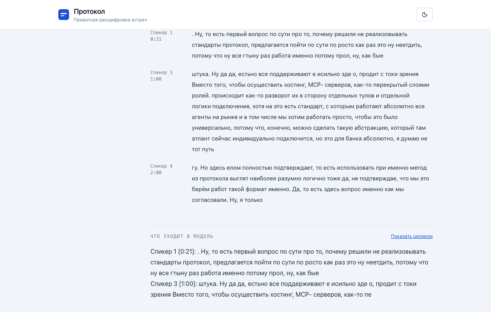
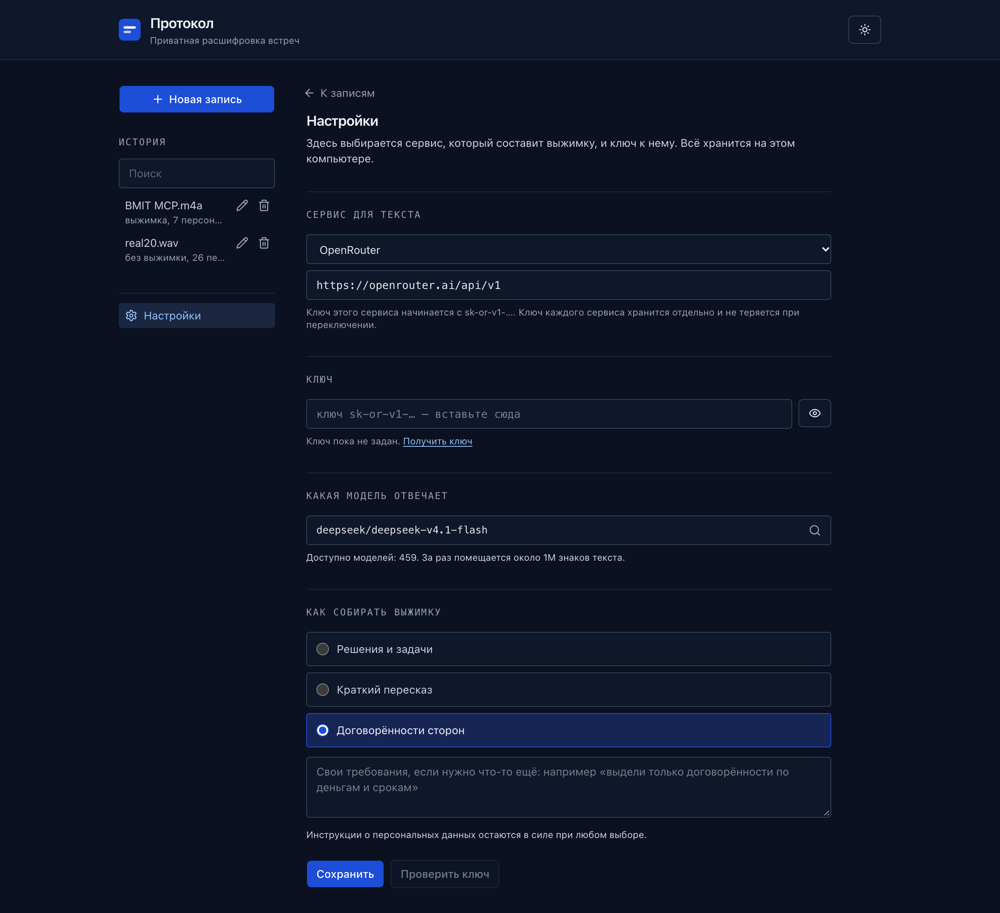

# Протокол

Приватная расшифровка встреч: запись превращается в транскрипт, персональные
данные в нём маскируются, и только обезличенный текст уходит в LLM. Оригиналы
остаются на машине.

Продуктовая документация: [docs/PRODUCT.md](docs/PRODUCT.md). Для администраторов: [docs/ADMIN.md](docs/ADMIN.md). Выдача лицензий: [docs/LICENSING.md](docs/LICENSING.md).


## Что умеет

- Расшифровка записи на CPU, локально. Длительность не ограничена:75-минутная
  запись разбирается примерно за полторы минуты.
- Маскирование персональных данных перед отправкой в модель.
- Разделение по говорящим для встреч с несколькими участниками.
- Протокол встречи (суть, решения, задачи) с учётом того, кто что сказал, и с обратной подстановкой ПДн.
- Протокол выводится документом: заголовки, списки и выделения, без разметочных символов.
- Копирование транскрипта и ответа, выгрузка отчёта в `.txt` и печать/сохранение в PDF.
- История сессий на этом Mac: файл `sessions.json` рядом с настройками, до 50 записей;
  поиск по названию, переименование и удаление.
- Светлая и тёмная темы.

## Зачем это нужно

Отправить транскрипт рабочего звонка в LLM напрямую означает отдать туда имена,
номера телефонов, паспортные данные и реквизиты. Этот инструмент разрывает цепочку
перед самой моделью: в OpenRouter уходит текст, в котором вместо личных данных
стоят токены вида `[PERSON_1]`, `[PHONE_1]`, `[PASSPORT_1]`. Ответ модели
разбирается локально, токены заменяются обратно на оригиналы, и восстановленный
текст никуда не уходит.

```
Аудио → транскрипт → маскирование PII → OpenRouter → разбор ответа → итог
        локально      локально            единственное   локально
                                      обращение в сеть
```

## Скриншоты

**Пустое состояние.** Запись перетаскивается в окно или выбирается файлом. Это же
окно объясняет, что происходит с данными: `01 · АУДИО → 02 · МАСКИРОВАНИЕ → 03 · ПРОТОКОЛ`.


**Результат.** Один документ: выжимка сверху, ниже транскрипт с подсветкой
найденных сущностей и свёрнутый блок «что уходит в модель». Разделы сворачиваются,
выжимки по режимам хранятся все сделанные — переключение между ними не
обращается к модели. Плашки `PERSON_1`, `PHONE_1` показывают, что именно было
скрыто.


**Встреча с несколькими участниками.** Транскрипт разбит по репликам: метка
говорящего и таймкод слева, текст справа; подсветка сущностей внутри реплик.


**Поиск по расшифровке.** Поле стоит в шапке документа и остаётся доступным,
когда раздел свёрнут; совпадения подсвечены, Enter листает их дальше.



**Тёмная тема.** Та же система на тёмном фоне, переключается в шапке.


**Настройки.** Сервис для текста списком, ключ и его состояние.




**История.** Поиск по названию и переименование прямо в списке.


**На 375px.** Одна колонка без горизонтальной прокрутки.


Снимки делает `npm --prefix web run shots` из текущей сборки. Встреча в них вымышленная:
имена, телефон, паспорт и адрес придуманы, реальных данных нет.

## Что внутри

| Этап | Модель | Рантайм |
| --- | --- | --- |
| STT | `istupakov/gigaam-v3-onnx` (вариант `e2e-rnnt`, `int8`) | `onnx-asr`, CPU |
| PII-NER | `lockR/rubert-base-pii-ner-onnx` | `onnxruntime`, CPU |
| Диаризация | `onnx-community/pyannote-segmentation-3.0` + 3D-Speaker `CAM++` | `onnxruntime`, CPU |
| LLM | OpenRouter API | `httpx` |

Диаризация включается сама, когда в записи больше одного говорящего: сегментация
pyannote находит смены говорящего, модель CAM++ считает голосовой эмбеддинг каждой
реплики, а кластеризация по косинусу разводит их по спикерам. Транскрипт показывается
репликами с метками «Спикер 1/2/…» и таймкодами. Модели маленькие (~33 МБ) и лежат в
`models/`; без них приложение работает, просто без меток.

## Модели и лицензии

| Модель | Источник | Лицензия |
| --- | --- | --- |
| STT, GigaAM v3 (e2e RNN-T) | [ai-sage/GigaAM-v3](https://huggingface.co/ai-sage/GigaAM-v3), ONNX-экспорт [istupakov/gigaam-v3-onnx](https://huggingface.co/istupakov/gigaam-v3-onnx) | MIT |
| PII-NER | [redmadrobot-rnd/rubert-base-pii-ner](https://huggingface.co/redmadrobot-rnd/rubert-base-pii-ner), ONNX-экспорт [lockR/rubert-base-pii-ner-onnx](https://huggingface.co/lockR/rubert-base-pii-ner-onnx) | Apache-2.0 |
| Основа PII-NER | [ai-forever/ruBert-base](https://huggingface.co/ai-forever/ruBert-base) | Apache-2.0 |
| Обучающие данные PII-NER | [redmadrobot-rnd/pii_train](https://huggingface.co/datasets/redmadrobot-rnd/pii_train) | MIT |
| Сегментация речи | [pyannote/segmentation-3.0](https://huggingface.co/pyannote/segmentation-3.0), ONNX-экспорт [onnx-community/pyannote-segmentation-3.0](https://huggingface.co/onnx-community/pyannote-segmentation-3.0) | MIT |
| Голосовые эмбеддинги, CAM++ | 3D-Speaker (ModelScope), ONNX-экспорт [Luigi/campplus-zh-en-onnx](https://huggingface.co/Luigi/campplus-zh-en-onnx) | Apache-2.0 |
| Морфологические словари | [pymorphy3-dicts-ru](https://pypi.org/project/pymorphy3-dicts-ru/) | код MIT, данные CC BY-SA |

Спасибо Red Mad Robot R&D за модель PII-NER и её обучающие данные. Карточка модели
просит указывать авторов и ссылаться на исходный репозиторий при публикации результатов.
Apache-2.0 и CC BY-SA требуют сохранять уведомления о лицензии при распространении.
Условия pyannote принимаются на странице модели. Наборы для оценки (PII-Bench,
`redmadrobot-rnd/pii_benchmark`) в репозиторий не входят.

## Установка

Два варианта, выберите по машине.

**1. Нативное десктоп-приложение.** То, чем пользуется конечный пользователь.
Двойной клик, без Docker и терминала. Основная цель: MacBook (Apple Silicon),
Linux-сборка тоже собирается и проверена.

```bash
./desktop/build.sh           # цель выбирается по платформе: mac или linux
./desktop/build.sh --mac     # только на маке: бандл не кросс-компилируется
```

Сборка получается самостоятельной: внутри лежит Python-сайдкар (ONNX-рантайм,
разборщик аудио на PyAV, модели весом ~0.7 ГБ) и веб-интерфейс. Отдельно
устанавливать модели не нужно: на этапе сборки они вшиваются в приложение, и
при запуске ничего не докачивается.

Проверка готовой сборки: `./desktop/verify.sh`

Проверка интерфейса живёт в `benchmarks/ui_audit.py` и запускается сама из
`verify.sh`: обходит три экрана в обеих темах, сверяет контраст каждой пары
«текст на фоне» по WCAG 1.4.3, меряет переполнение на четырёх ширинах и при
зуме 200 %, и рендерит печать, чтобы убедиться, что на бумаге не остаётся ни
одной кнопки. Свой минимальный WebSocket-клиент лежит рядом — `verify.sh`
зовёт системный `python3`, где нет `websocket`, а проверка, которая молча
пропускает себя, хуже отсутствующей: она превращает «проверено» в «ничего не
произошло».: поднимает сайдкар, загружает
модели и прогоняет настоящее маскирование.

Подробнее о сборке и о том, что именно попадает в бандл: [DESKTOP.md](DESKTOP.md).

**2. Docker.** Для разработки и проверки на любой машине:

```bash
# 1. Модели, ~0.7 ГБ, один раз
./download_models.sh

# 2. Поднять
docker compose up --build
```

UI: http://localhost:3000 · API: http://localhost:8000/docs

Ключ OpenRouter и модель задаются **в самом приложении**: «Настройки» в левой панели →
вставьте ключ, нажмите «Проверить ключ», выберите модель из списка с поиском.
В Docker то же самое: `GET /api/settings` покажет, есть ли ключ. Переменные
`OPENROUTER_API_KEY` и `LLM_MODEL` по-прежнему работают и имеют приоритет над
файлом — они нужны для CI и headless-запусков, где диалога нет.

Что уходит провайдеру, настраивается переменными окружения (значения по умолчанию безопасны):

- `LLM_DATA_COLLECTION` — `deny` (по умолчанию): запрос не попадает к провайдерам, которые
  хранят промпты или обучаются на них. `allow` возвращает поведение OpenRouter по умолчанию.
- `LLM_ZDR=1` — только эндпоинты с политикой Zero Data Retention. Включайте, если нужна
  эта гарантия: для части моделей таких эндпоинтов нет, и запрос тогда падает с ошибкой.
- `LLM_REASONING_EFFORT` — насколько модель рассуждает перед ответом (`low`, `medium`,
  `high`); пусто — как у провайдера.

Персональные данные в требованиях к выжимке («Свои требования») маскируются так же,
как расшифровка: имя, которое есть в записи, заменяется её токеном, а незнакомое
имя блокирует запрос с сообщением, что именно нужно убрать.

> Сборка бандла идёт платформа за платформой, без кросс-компиляции: `.app` собирается
> только на macOS (нужны инструменты Xcode для подписи), а Linux-таргеты
> (`AppImage`, `deb`) собираются на Linux. `onnxruntime` с CoreML ставится под arm64-маком.

## API

| Метод | Путь | Вход | Выход |
| --- | --- | --- | --- |
| POST | `/api/transcribe` | multipart `file` | `text`, `duration_sec` |
| POST | `/api/mask` | `{"text": "..."}` | `masked_text`, `entity_map`, `entities` |
| POST | `/api/analyse` | multipart `file` | NDJSON-поток: расшифровка, спикеры, маскирование |
| POST | `/api/summarize` | `{"cache_key": "...", "model": "...", "preset": "..."}` | `reply`, `reply_unmasked`, `cost` |
| POST | `/api/estimate` | `{"chars": 25000, "model": "..."}` | `tokens_in`, `requests`, `total` |
| GET | `/api/model-prices` | нет | цены всех моделей каталога, USD за миллион токенов |
| POST | `/api/process` | multipart `file` + `llm_model` | NDJSON-поток: всё сразу, в один проход |
| GET | `/api/settings` | нет | `has_key`, `key_hint`, `model`, `base_url` — сам ключ не возвращается |
| POST | `/api/settings` | `{"key": "...", "model": "..."}` | сохранено или причина отказа; пустые поля означают «оставить как есть» |
| POST | `/api/settings/verify` | `{"key": "...", "remember": true}` | проверка ключа через `/credits` OpenRouter |
| GET | `/api/models` | нет | каталог OpenRouter (458 моделей) для выпадашки с поиском |
| GET | `/api/health` | нет | наличие моделей и ключа |

## Два этапа вместо одного

Пайплайн разделён на `/api/analyse` и `/api/summarize`, потому что эти две
части стоят разного:

- **расшифровка** — дорогая по времени (≈30 с на 20 минут аудио на CPU) и
  бесплатная: наружу не уходит ничего;
- **выжимка** — платная, но мгновенная: это один вызов модели.

Разделение даёт три вещи, которых не было у `/api/process`:

1. **Повторная выжимка без повторной расшифровки.** Смена режима выжимки или
   правка требования стоит только вызова модели. На замере: повторный прогон
   того же файла — 0,025 с против 1,29 с.
2. **Экран проверки перед отправкой.** Маскированный текст можно прочитать
   целиком и увидеть смету до того, как что-либо уйдёт.
3. **Кэш по содержимому.** Ключ — `sha256(аудио + расширение + каталог модели)`,
   так что другой файл или другая модель распознавания никогда не получит
   чужую расшифровку. Хранится 8 последних записей рядом с файлом настроек.

`/api/process` оставлен: он нужен скриптам и тестам, и по-прежнему делает всё
за один проход. Приложение его не вызывает.

`/api/analyse`, как и `/api/process`, отдаёт поток `application/x-ndjson`: по
одной JSON-строке на этап, последняя несёт полный результат. Так UI показывает
честный прогресс-бар, а не имитацию.

### Смета

`/api/estimate` считает не «один запрос», а столько запросов, сколько пайплайн
реально сделает: `llm.MEETING_MAP_CHARS` = 24 000 знаков, дальше текст режется
на куски по 8 000 и сначала сжимается. Часовая запись — это десятки запросов, и
смета по одной цене за один запрос занижала бы счёт в разы.

Две константы в смете — предположения, а не измерения: `PARTIAL_COMPRESSION`
(0,15) и `TYPICAL_PARTIAL_TOKENS` (400). Ни одна запись длиннее одного запроса
ещё не прогонялась целиком с замером. На них влияет только цифра «примерно» до
отправки; точная сумма приходит от провайдера в `tokens_in`/`tokens_out` и
показывается после выжимки.

## Маскирование

Каждая сущность заменяется на токен вида `[PERSON_1]`, `[PHONE_1]`,
`[PASSPORT_1]`. Таблица подстановок возвращается вместе с ответом
(`entity_map`), после ответа модели токены обратно заменяются на оригиналы:
локально, поэтому восстановленный текст никуда не уходит.

Токены в скобках: так модель сохраняет их дословно, а обратная подстановка не
путает их с обычным текстом.

Сущности модели (21 тип) сводятся к типам подсветки:

| Тип | Что входит |
| --- | --- |
| `PERSON` | `FIRST_NAME`, `LAST_NAME`, `MIDDLE_NAME` |
| `ADDRESS` | `COUNTRY`, `REGION`, `DISTRICT`, `CITY`, `STREET`, `HOUSE` |
| `CARD` | `CREDIT_CARD` |
| `PHONE`, `EMAIL`, `URL`, `IP` | как в модели |
| `PASSPORT`, `INN`, `SNILS`, `OMS`, `DRIVER_LICENSE`, `MILITARY_ID`, `BIRTH_CERTIFICATE` | как в модели |

Соседние сущности одного типа склеиваются в один токен, поэтому
«Иван Петров» становится `[PERSON_1]`, а не двумя токенами. Граница склейки:
пробелы и разделители-запятые; через слово сущности не склеиваются.

Поверх модели работает слой правил для **структурных** ПДн, тех, где промах
модели означает утечку, а формат проверяем машинно: IP-адрес, ИНН, СНИЛС, номер
карты (алгоритм Луна), паспорт, телефон, полис ОМС. Правила находят их регулярным
выражением и контрольной суммой, поэтому не зависят от вероятности модели: там,
где модель рвёт `ИНН 7707083893` на `770708389` + хвост `3`, правило закрывает
целиком. Слабое место правил: форматы без контрольной суммы (водительское
удостоверение); их по-прежнему ловит модель. Если спан модели и спан правила
пересекаются, остаётся более длинный. Маскировать лишнее безопасно, пропустить
нельзя.

Длинные тексты режутся окнами 512 токенов со стридом 128, порог уверенности 0.3.

Правила также закрывают номера ОГРНИП (только рядом со словом «ОГРНИП»), трёхзначный код
с обратной стороны карты (рядом со словом «код», «CVC» или «ввожу» и в тексте про карту или
оплату), трёхзначный код без всякого контекста (как секрет), одноразовые коды и токены доступа
(тип `SECRET`), номера домов, квартир, подъездов и этажей, название улицы после «ул.» и дефисные
географические названия вроде «Санкт-Петербург», фамилию после «ИП», даже строчными буквами,
MAC-адреса (как `NUMBER`, а не как IP) и 11-значные номера, которые начинаются с 7 или 8, как
телефоны. КПП и ОГРН юридических лиц, регистрационный номер компании и 13-значный номер в
реквизитах или у поставщика маскируются типом `ORG_ID`: это не персональные данные, но они
называют контрагента, поэтому в модель уходят только маской.

Проверка на внешнем наборе PII-Bench (ru, 1 810 примеров, синтетика, Apache-2.0): токен-F1
96.8, точность 98.2, полнота 95.5. Покрытие считается по итоговой маске, той, что видит
модель. Полностью покрыты ИНН, СНИЛС, номер карты, телефон, e-mail, КПП, ОГРН, CVC, имена и
значимые части адреса. ОГРНИП и токены покрыты на 98.9% (по одному пропуску из 87 и 95). У
паспорта маскируются все цифры, а слова «серия» и «номер» остаются открытыми. Официальный
бенчмарк модели (2 839 предложений): F1 96.4.

## Протокол встречи

В модель уходит **маскированный диалог с метками говорящих и таймкодами**:
`Спикер 2 [12:34]: …`. Так она видит, кто что сказал, а персональные данные уже
заменены токенами, порядок не меняется: сначала маскируем, потом отправляем.
Модель возвращает протокол: суть встречи, ключевые обсуждённые пункты, принятые
решения, задачи (что, кто, срок, если названо), открытые вопросы. Токены в
ответе заменяются обратно на оригиналы локально.

Длинная встреча (больше ~24 000 символов) сначала сжимается по частям, затем
протокол собирается из тезисов: один запрос не тащит час транскрипта целиком.
На каждом шаге отправляется только маскированный текст.

## Транскрибация встречи

Запись распознаётся **одним проходом по всему аудио**: модель держит контекст
целиком, а не по кусочкам-репликам, и возвращает таймкод каждого слова.
Диаризация даёт реплики говорящих, и каждое слово привязывается к той реплике, в
которой оно **началось**: так текст остаётся цельным и промаркирован, а не рвётся
по границам. Длинные записи режутся на куски по тишине (≤120 с) со сдвигом
таймкодов на смещение куска.

## Важно: почему STT берёт `e2e`

Обычная голова `gigaam-v3` распознаёт продиктованные цифры словами:
«восемь девятьсот двенадцать...». NER не считает это номером телефона, и число
уходит в OpenRouter открытым. Вариант `e2e` нормализует цифры и ставит
пунктуацию, после чего NER корректно заменяет номер на `[PHONE_1]`. Это
требование приватности, а не вопрос качества распознавания.

Голова выбрана по измерениям при одинаковых кусках по 20 с: `e2e-rnnt` даёт 3.84%
ошибок в словах на FLEURS (300 фрагментов, звук нормирован) против 4.09% у
`e2e-ctc`, и 4.00% на записи с эталоном против 4.35%. Скорость одинаковая, обе
головы пишут цифрами одинаковую долю чисел. Куски важнее головы: на 120-секундных
кусках обе головы теряли речь (на записи с эталоном CTC 5.83% против 4.35%, RNN-T 5.04% против 4.00%).

Проверен и отклонён `nemo-parakeet-tdt-0.6b-v3` (int8, те же куски по 20 с): FLEURS
7.69% против 3.84%, запись с эталоном 5.83% против 4.00%, цифр 28 из 41 против 36.
Для маскирования номеров это хуже, поэтому модель не используется.

Модель берётся в **int8**-экспорте: на тестах качество то же (0% WER на чистой
речи, +0.8 п.п. при шуме 0 дБ: одно слово из 122), но грузится на ~0.5 ГБ
легче (470 МБ RSS против 790) и весит втрое меньше в бандле (225 МБ против 845).

## Ограничения

- IP-адреса и СНИЛС: слабые места самой модели; их закрывает слой правил (см.
  «Маскирование»), поэтому в пайплайне они маскируются. Уязвимы типы без
  контрольной суммы и устойчивого формата, например, водительское удостоверение.
- Пропуски на PII-Bench: по одному ОГРНИП и одному токену без слов рядом, служебные слова
  адреса («ул», «кв») и слова «серия», «номер» у паспорта. Их не маскируем намеренно: они
  не идентифицируют.
- **Длинная запись (встреча) режется на куски до 120 с по тишине.** Модель STT держит
  около 200 с за вызов, дальше ONNX-граф падает. Куски транскрибируются по очереди и
  склеиваются.
- **Диаризация: оценка по голосам, без имён.** Метки «Спикер 1/2/…» относительные:
  по ним нельзя сказать, кто именно. Число говорящих не ограничено, и на реальном
  12-минутном звонке с семью участниками модель их разводит; на 16 файлах VoxConverse
  (in-the-wild) средняя DER ~18%. Но это именно оценка, а не гарантия: на шумной и
  наложенной речи голосовые эмбеддинги путаются: один голос дробится на осколки, и
  их складывает в ближайшего соседа слой кластеризации, поэтому на сложных записях
  число меток может отличаться на 1–2. Наложенная речь не моделируется: слово
  попадает в одну реплику (по началу слова).
- **Почему CAM++, а не end-to-end Sortformer.** У NVIDIA Sortformer (тоже ONNX, без
  torch) ошибка на VoxConverse ниже (~12%), но он жёстко ограничен **четырьмя**
  говорящими, и на семи участниках он врёт по определению. CAM++ не имеет потолка и
  на этом звонке дал все семь меток.
- Обратная подстановка ищет токены дословно (допускаются пропавшие скобки).
  Если модель перепишет `[PERSON_1]` в `PERSON 1`, подстановка не сработает.
- История сессий лежит файлом `sessions.json` рядом с файлом настроек, а не в `localStorage`
  браузера: порт приложения меняется при каждом запуске, и браузерное хранилище теряло
  историю. БД нет.
- На macOS включается ускорение CoreML, но проверить его включение и подпись
  приложения можно только на самом маке, см. `./desktop/verify.sh`.

## Разработка без Docker

```bash
./download_models.sh

cd api
python3.12 -m venv .venv    # не голый python3: на macOS это Xcode-питон 3.9/3.10
.venv/bin/pip install -r requirements.txt
.venv/bin/pip install pytest     # для тестов; в requirements.txt его нет
.venv/bin/uvicorn main:app --reload --port 8000

cd ../web && npm install && npm run dev   # UI на :3000, /api проксируется
```

Нужен Python 3.11+. На macOS `python3` указывает на питон из Xcode (3.9/3.10), поэтому
именно `python3.12`/`python3.13` из Homebrew. `desktop/build.sh` подбирает
подходящий интерпретатор сам; здесь команды написаны явно, потому что это
ручной сценарий.

Тесты маскирования (единственное место, где ошибка молча пропускает PII) и
тесты разбора аудио:

```bash
cd api && .venv/bin/python -m pytest tests -q
```

Проверка интерфейса в браузере (Playwright, нужен установленный Google Chrome): загрузка
записи, выжимки по режимам, закреплённая история, тёмная тема, телефонная ширина. Скрипт сам
поднимает сайдкар и заглушку модели, данные пишет во временную папку:

```bash
cd web && E2E_AUDIO=/путь/к/записи.wav npm run e2e
```

`E2E_TARGET=bundle` проверяет сайдкар внутри собранного приложения (нужна сборка
`desktop/build.sh --mac`).

Внешний набор PII-Bench (ru) в репозиторий не входит. Скачайте два файла из папки `data/`
на [huggingface.co/datasets/hivetrace/pii-bench](https://huggingface.co/datasets/hivetrace/pii-bench/tree/main/data)
(`domain-…parquet` и `entity-…parquet`) в одну папку. Для чтения нужен `pyarrow`, он нужен
только бенчмарку:

```bash
api/.venv/bin/python -m pip install pyarrow
```

Запуск, из корня репозитория:

```bash
api/.venv/bin/python benchmarks/run_pii_bench_ru.py <папка с parquet-файлами>
```

## Отклонения от исходной схемы

- `ProcessRequest.audio_url` заменён на multipart-загрузку: UI принимает файл
  перетаскиванием, а тягать аудио по URL это лишняя поверхность для SSRF.
- `POST /api/process` отдаёт NDJSON-поток вместо единого JSON ради прогресс-бара.
- Приложение ходит не в `/api/process`, а в `/api/analyse` → `/api/summarize`:
  это нужно, чтобы повторная выжимка не пересчитывала расшифровку и чтобы перед
  отправкой можно было показать, что именно уйдёт. `/api/process` остался для
  скриптов.
- Вместо штатного `pii_ner.py` из репозитория модели используется свой
  CPU-рантайм: апстрим-обёртка жёстко требует CUDA. Логика окон и разбора
  спанов взята из неё без изменений (Apache-2.0).
- Декодирование аудио идёт через PyAV, а не через вызов внешнего `ffmpeg`:
  библиотеки FFmpeg поставляются вместе с питоновским пакетом и попадают в бандл,
  так что приложению не нужен установленный `ffmpeg`.
