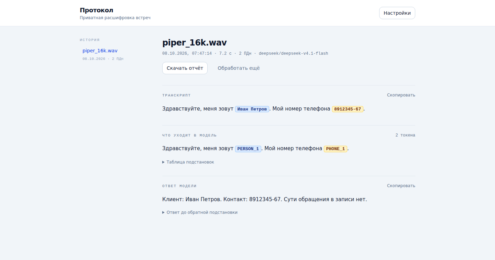
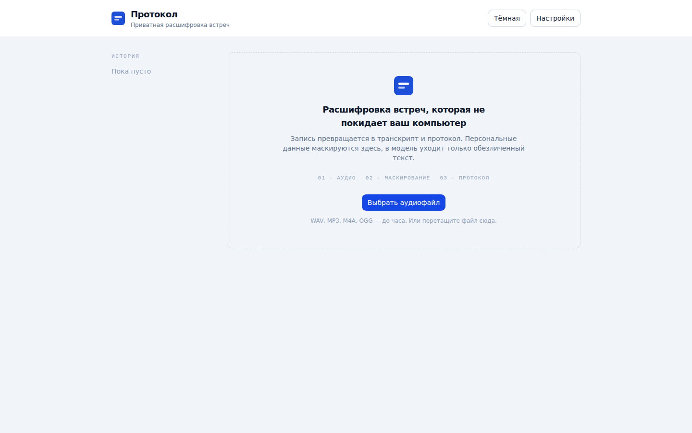
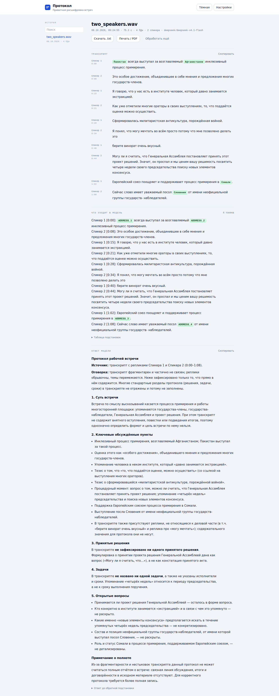
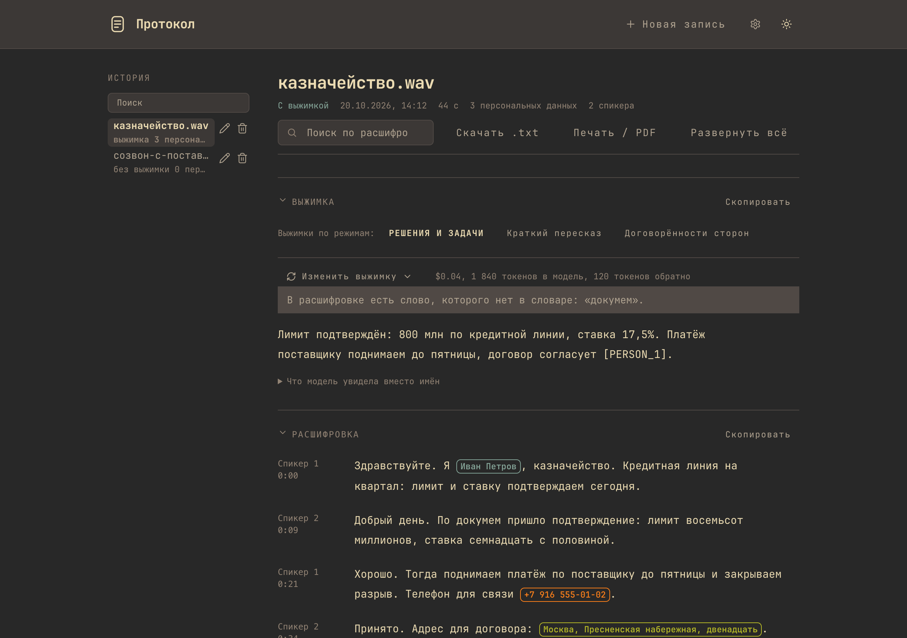
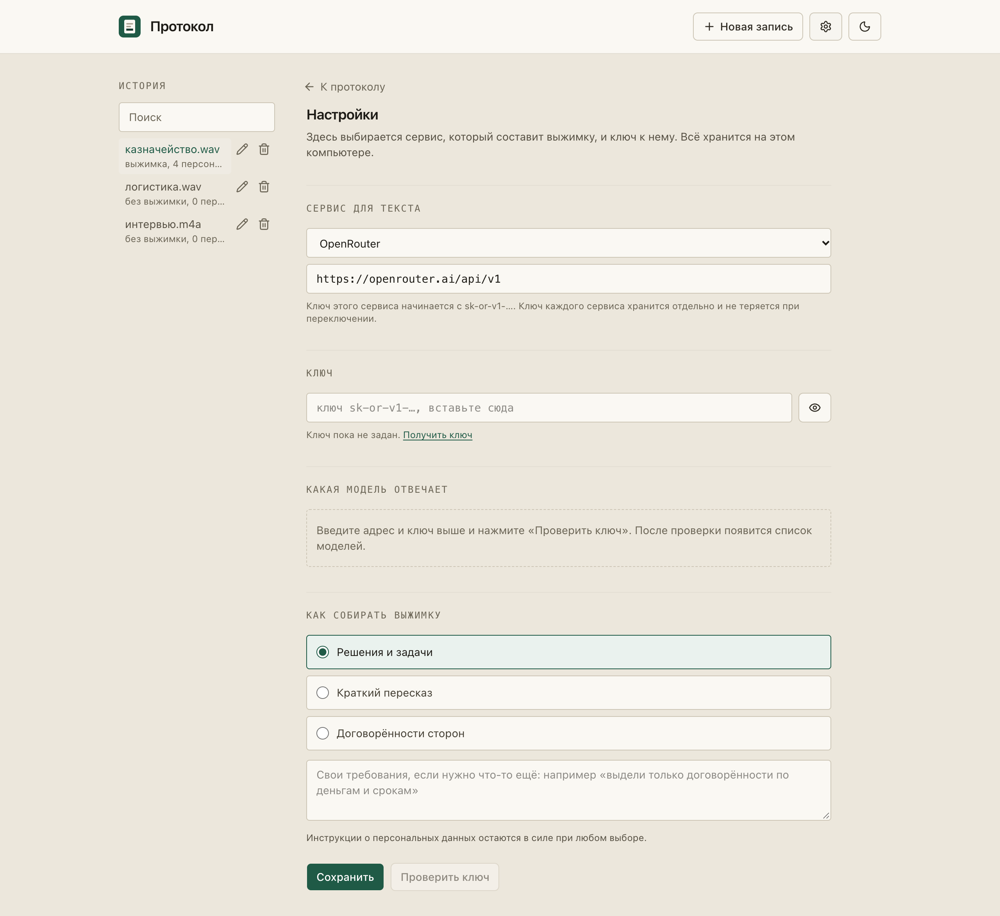
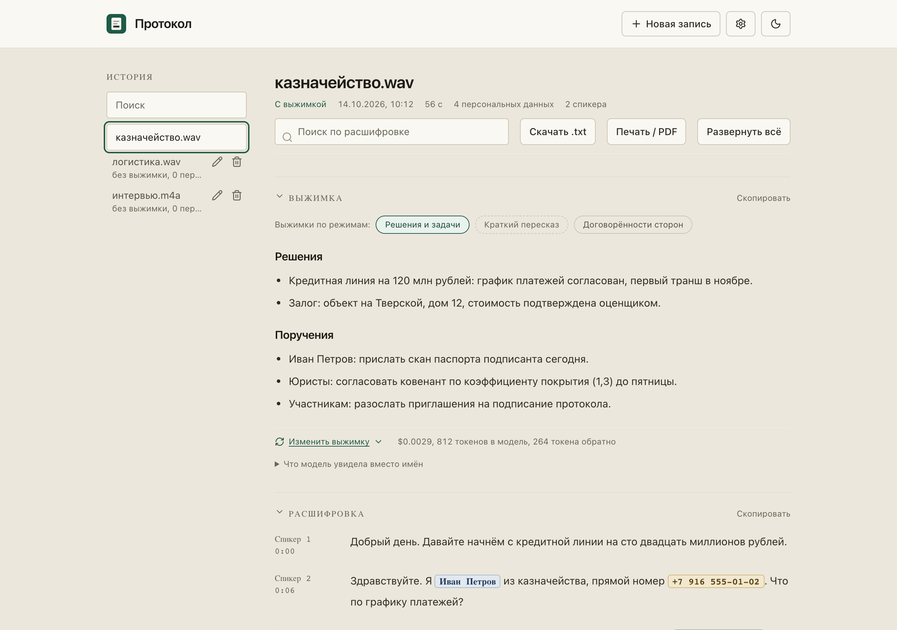
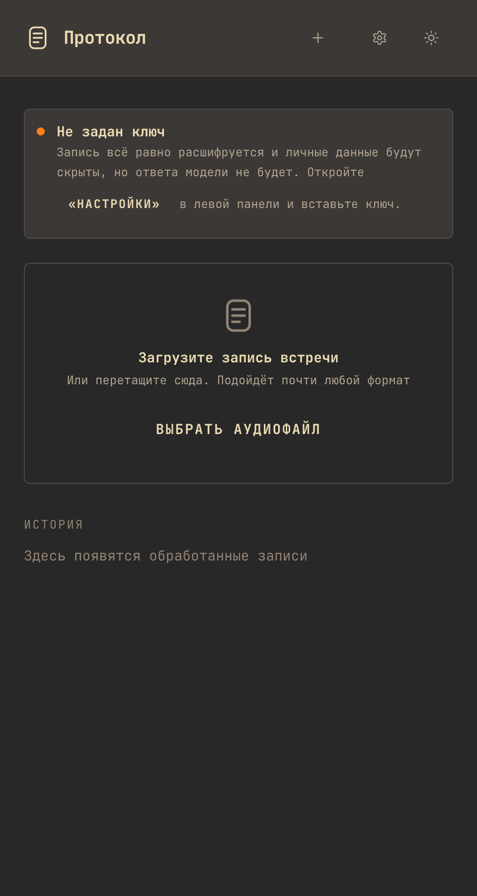

# Протокол

Приватная расшифровка встреч: запись превращается в транскрипт, персональные
данные в нём маскируются, и только обезличенный текст уходит в LLM. Оригиналы
остаются на машине.



## Что умеет

- Расшифровка записи (до часа) на CPU, локально.
- Маскирование персональных данных перед отправкой в модель.
- Разделение по говорящим для встреч с несколькими участниками.
- Протокол встречи (суть, решения, задачи) с учётом того, кто что сказал, и с обратной подстановкой ПДн.
- Протокол выводится документом: заголовки, списки и выделения, без разметочных символов.
- Копирование транскрипта и ответа, выгрузка отчёта в `.txt` и печать/сохранение в PDF.
- История сессий в браузере (localStorage): поиск по названию, переименование и удаление.
- Светлая и тёмная темы.

## Зачем это нужно

Отправить транскрипт рабочего звонка в LLM напрямую означает отдать туда имена,
номера телефонов, паспортные данные и реквизиты. Этот инструмент разрывает цепочку
перед самой моделью: в OpenRouter уходит текст, в котором вместо личных данных
стоят токены вида `[PERSON_1]`, `[PHONE_1]`, `[PASSPORT_1]`. Ответ модели
разбирается локально, токены заменяются обратно на оригиналы, и восстановленный
текст никуда не уходит.

```
Аудио → транскрипт → маскирование PII → OpenRouter → разбор ответа → итог
        локально      локально            единственное   локально
                                      обращение в сеть
```

## Скриншоты

**Пустое состояние.** Запись перетаскивается в окно или выбирается файлом. Это же
окно объясняет, что происходит с данными: `01 · АУДИО → 02 · МАСКИРОВАНИЕ → 03 · ПРОТОКОЛ`.



**Результат.** Один документ из трёх разделов: транскрипт с подсветкой найденных
сущностей, замаскированный текст, ответ модели с восстановленными значениями.
Плашки `PERSON_1`, `PHONE_1` показывают, что именно было скрыто.


**Встреча с несколькими участниками.** Транскрипт разбит по репликам: метка
говорящего и таймкод слева, текст справа; подсветка сущностей внутри реплик.



**Тёмная тема.** Та же система на тёмном фоне, переключается в шапке.



**Настройки.** Модель и статус ключа OpenRouter.



**История.** Поиск по названию и переименование прямо в списке.



**На 375px.** Одна колонка без горизонтальной прокрутки.



## Что внутри

| Этап | Модель | Рантайм |
| --- | --- | --- |
| STT | `istupakov/gigaam-v3-onnx` (вариант `e2e-ctc`, `int8`) | `onnx-asr`, CPU |
| PII-NER | `lockR/rubert-base-pii-ner-onnx` | `onnxruntime`, CPU |
| Диаризация | `onnx-community/pyannote-segmentation-3.0` + 3D-Speaker `CAM++` | `onnxruntime`, CPU |
| LLM | OpenRouter API | `httpx` |

Диаризация включается сама, когда в записи больше одного говорящего: сегментация
pyannote находит смены говорящего, модель CAM++ считает голосовой эмбеддинг каждой
реплики, а кластеризация по косинусу разводит их по спикерам. Транскрипт показывается
репликами с метками «Спикер 1/2/…» и таймкодами. Модели маленькие (~33 МБ) и лежат в
`models/`; без них приложение работает, просто без меток.

## Установка

Два варианта, выберите по машине.

**1. Нативное десктоп-приложение.** То, чем пользуется конечный пользователь.
Двойной клик, без Docker и терминала. Основная цель: MacBook (Apple Silicon),
Linux-сборка тоже собирается и проверена.

```bash
./desktop/build.sh           # цель выбирается по платформе: mac или linux
./desktop/build.sh --mac     # только на маке: бандл не кросс-компилируется
```

Сборка получается самостоятельной: внутри лежит Python-сайдкар (ONNX-рантайм,
разборщик аудио на PyAV, модели весом ~0.9 ГБ) и веб-интерфейс. Отдельно
устанавливать модели не нужно: на этапе сборки они вшиваются в приложение, и
при запуске ничего не докачивается.

Проверка готовой сборки: `./desktop/verify.sh`: поднимает сайдкар, загружает
модели и прогоняет настоящее маскирование.

Подробнее о сборке и о том, что именно попадает в бандл: [DESKTOP.md](DESKTOP.md).

**2. Docker.** Для разработки и проверки на любой машине:

```bash
# 1. Модели, ~0.9 ГБ, один раз
./download_models.sh

# 2. Ключ OpenRouter
export OPENROUTER_API_KEY=sk-or-...

# 3. Поднять
docker compose up --build
```

UI: http://localhost:3000 · API: http://localhost:8000/docs

> Сборка бандла идёт платформа за платформой, без кросс-компиляции: `.app` собирается
> только на macOS (нужны инструменты Xcode для подписи), а Linux-таргеты
> (`AppImage`, `deb`) собираются на Linux. `onnxruntime` с CoreML ставится под arm64-маком.

## API

| Метод | Путь | Вход | Выход |
| --- | --- | --- | --- |
| POST | `/api/transcribe` | multipart `file` | `text`, `duration_sec` |
| POST | `/api/mask` | `{"text": "..."}` | `masked_text`, `entity_map`, `entities` |
| POST | `/api/llm` | `{"masked_text": "...", "model": "..."}` | `reply`, `reply_unmasked` |
| POST | `/api/process` | multipart `file` + `llm_model` | NDJSON-поток с прогрессом и результатом |
| GET | `/api/health` | — | наличие моделей и ключа |

`/api/process` отдаёт поток `application/x-ndjson`: по одной JSON-строке на этап
(`transcribe` → `mask` → `llm` → `done`), последняя несёт полный результат. Так
UI показывает честный прогресс-бар, а не имитацию.

## Маскирование

Каждая сущность заменяется на токен вида `[PERSON_1]`, `[PHONE_1]`,
`[PASSPORT_1]`. Таблица подстановок возвращается вместе с ответом
(`entity_map`), после ответа модели токены обратно заменяются на оригиналы:
локально, поэтому восстановленный текст никуда не уходит.

Токены в скобках: так модель сохраняет их дословно, а обратная подстановка не
путает их с обычным текстом.

Сущности модели (21 тип) сводятся к типам подсветки:

| Тип | Что входит |
| --- | --- |
| `PERSON` | `FIRST_NAME`, `LAST_NAME`, `MIDDLE_NAME` |
| `ADDRESS` | `COUNTRY`, `REGION`, `DISTRICT`, `CITY`, `STREET`, `HOUSE` |
| `CARD` | `CREDIT_CARD` |
| `PHONE`, `EMAIL`, `URL`, `IP` | как в модели |
| `PASSPORT`, `INN`, `SNILS`, `OMS`, `DRIVER_LICENSE`, `MILITARY_ID`, `BIRTH_CERTIFICATE` | как в модели |

Соседние сущности одного типа склеиваются в один токен, поэтому
«Иван Петров» становится `[PERSON_1]`, а не двумя токенами. Граница склейки:
пробелы и разделители-запятые; через слово сущности не склеиваются.

Поверх модели работает слой правил для **структурных** ПДн, тех, где промах
модели означает утечку, а формат проверяем машинно: IP-адрес, ИНН, СНИЛС, номер
карты (алгоритм Луна), паспорт, телефон, полис ОМС. Правила находят их регулярным
выражением и контрольной суммой, поэтому не зависят от вероятности модели: там,
где модель рвёт `ИНН 7707083893` на `770708389` + хвост `3`, правило закрывает
целиком. Слабое место правил: форматы без контрольной суммы (водительское
удостоверение); их по-прежнему ловит модель. Если спан модели и спан правила
пересекаются, остаётся более длинный. Маскировать лишнее безопасно, пропустить
нельзя.

Длинные тексты режутся окнами 512 токенов со стридом 128, порог уверенности 0.3.

## Протокол встречи

В модель уходит **маскированный диалог с метками говорящих и таймкодами**:
`Спикер 2 [12:34]: …`. Так она видит, кто что сказал, а персональные данные уже
заменены токенами, порядок не меняется: сначала маскируем, потом отправляем.
Модель возвращает протокол: суть встречи, ключевые обсуждённые пункты, принятые
решения, задачи (что, кто, срок, если названо), открытые вопросы. Токены в
ответе заменяются обратно на оригиналы локально.

Длинная встреча (больше ~24 000 символов) сначала сжимается по частям, затем
протокол собирается из тезисов: один запрос не тащит час транскрипта целиком.
На каждом шаге отправляется только маскированный текст.

## Транскрибация встречи

Запись распознаётся **одним проходом по всему аудио**: модель держит контекст
целиком, а не по кусочкам-репликам, и возвращает таймкод каждого слова.
Диаризация даёт реплики говорящих, и каждое слово привязывается к той реплике, в
которой оно **началось**: так текст остаётся цельным и промаркирован, а не рвётся
по границам. Длинные записи режутся на куски по тишине (≤120 с) со сдвигом
таймкодов на смещение куска.

## Важно: почему STT берёт `e2e-ctc`

Обычный `gigaam-v3-ctc` распознаёт продиктованные цифры словами:
«восемь девятьсот двенадцать...». NER не считает это номером телефона, и число
уходит в OpenRouter открытым. Вариант `gigaam-v3-e2e-ctc` нормализует цифры и
ставит пунктуацию, после чего NER корректно заменяет номер на `[PHONE_1]`.
Это требование приватности, а не вопрос качества распознавания.

Модель берётся в **int8**-экспорте: на тестах качество то же (0% WER на чистой
речи, +0.8 п.п. при шуме 0 дБ: одно слово из 122), но грузится на ~0.5 ГБ
легче (470 МБ RSS против 790) и весит втрое меньше в бандле (225 МБ против 845).

## Ограничения

- IP-адреса и СНИЛС: слабые места самой модели; их закрывает слой правил (см.
  «Маскирование»), поэтому в пайплайне они маскируются. Уязвимы типы без
  контрольной суммы и устойчивого формата, например, водительское удостоверение.
- **Длинная запись (встреча) режется на куски до 120 с по тишине.** Модель STT держит
  около 200 с за вызов, дальше ONNX-граф падает. Куски транскрибируются по очереди и
  склеиваются.
- **Диаризация: оценка по голосам, без имён.** Метки «Спикер 1/2/…» относительные:
  по ним нельзя сказать, кто именно. Число говорящих не ограничено, и на реальном
  12-минутном звонке с семью участниками модель их разводит; на 16 файлах VoxConverse
  (in-the-wild) средняя DER ~18%. Но это именно оценка, а не гарантия: на шумной и
  наложенной речи голосовые эмбеддинги путаются: один голос дробится на осколки, и
  их складывает в ближайшего соседа слой кластеризации, поэтому на сложных записях
  число меток может отличаться на 1–2. Наложенная речь не моделируется: слово
  попадает в одну реплику (по началу слова).
- **Почему CAM++, а не end-to-end Sortformer.** У NVIDIA Sortformer (тоже ONNX, без
  torch) ошибка на VoxConverse ниже (~12%), но он жёстко ограничен **четырьмя**
  говорящими, и на семи участниках он врёт по определению. CAM++ не имеет потолка и
  на этом звонке дал все семь меток.
- Обратная подстановка ищет токены дословно (допускаются пропавшие скобки).
  Если модель перепишет `[PERSON_1]` в `PERSON 1`, подстановка не сработает.
- История сессий живёт в `localStorage` браузера, намеренно, без БД.
- На macOS включается ускорение CoreML, но проверить его включение и подпись
  приложения можно только на самом маке, см. `./desktop/verify.sh`.

## Разработка без Docker

```bash
./download_models.sh

cd api
python3.12 -m venv .venv    # не голый python3: на macOS это Xcode-питон 3.9/3.10
.venv/bin/pip install -r requirements.txt
.venv/bin/pip install pytest     # для тестов; в requirements.txt его нет
.venv/bin/uvicorn main:app --reload --port 8000

cd ../web && npm install && npm run dev   # UI на :3000, /api проксируется
```

Нужен Python 3.11+. На macOS `python3` указывает на питон из Xcode (3.9/3.10), поэтому
именно `python3.12`/`python3.13` из Homebrew. `desktop/build.sh` подбирает
подходящий интерпретатор сам; здесь команды написаны явно, потому что это
ручной сценарий.

Тесты маскирования (единственное место, где ошибка молча пропускает PII) и
тесты разбора аудио:

```bash
cd api && .venv/bin/python -m pytest tests -q
```

## Отклонения от исходной схемы

- `ProcessRequest.audio_url` заменён на multipart-загрузку: UI принимает файл
  перетаскиванием, а тягать аудио по URL это лишняя поверхность для SSRF.
- `POST /api/process` отдаёт NDJSON-поток вместо единого JSON ради прогресс-бара.
- Вместо штатного `pii_ner.py` из репозитория модели используется свой
  CPU-рантайм: апстрим-обёртка жёстко требует CUDA. Логика окон и разбора
  спанов взята из неё без изменений (Apache-2.0).
- Декодирование аудио идёт через PyAV, а не через вызов внешнего `ffmpeg`:
  библиотеки FFmpeg поставляются вместе с питоновским пакетом и попадают в бандл,
  так что приложению не нужен установленный `ffmpeg`.
